  

<!-- TODO: troque SEU-USUARIO pelos seus links reais -->

 

Sou estudante de **Engenharia de Software no iCEV** e tenho como objetivo atuar como desenvolvedor **Full Stack**.
Venho construindo experiência prática em **Quality Assurance**, com **testes de API** e **testes automatizados** (Selenium, Playwright e Cypress), e também trabalho com HTML, CSS, JavaScript e React.js.

 

  

## 🛰️ Expedições

| Expedição | Descrição |
| :-- | :-- |
| [**Chess Challenge III**](https://github.com/AlexandreCavalcantee/chess-challenge) | Motor de xadrez desenvolvido em equipe para o desafio do iCEV |
<!-- Copie a linha acima para adicionar mais projetos:
| [**Nome do projeto**](https://github.com/j-tiago/NOME-DO-REPO) | Uma frase sobre o que ele faz |
-->

## 🌌 Registro de voo

  

<!-- A cobrinha é gerada pelo workflow .github/workflows/snake.yml -->
<picture>
  <source media="(prefers-color-scheme: dark)" srcset="https://raw.githubusercontent.com/j-tiago/j-tiago/output/github-contribution-grid-snake-dark.svg">
  <source media="(prefers-color-scheme: light)" srcset="https://raw.githubusercontent.com/j-tiago/j-tiago/output/github-contribution-grid-snake.svg">
  
</picture>

 

