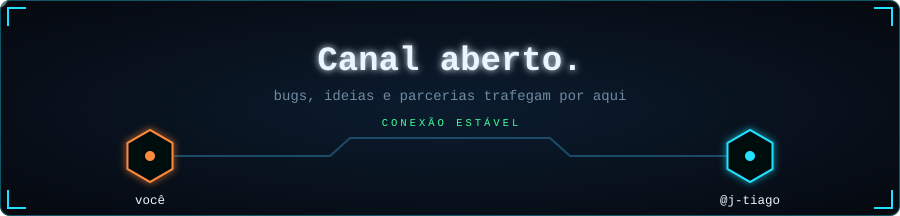

  

<!-- TODO: troque SEU-USUARIO pelo seu usuário do Instagram -->

 

Sou estudante de **Engenharia de Software no iCEV** (formatura prevista para nov/2027), com 18 meses de experiência prática em tecnologia na **MobiMark**, atuando em desenvolvimento de interfaces **web e mobile**, **testes de software** e **validação de APIs**.
Programo em **Python, JavaScript e Kotlin** e automatizo testes com **Selenium, Pytest** e pipelines de **CI/CD**.

 

  

## `/projetos`

| Projeto | Descrição |
| :-- | :-- |
| [**Chess Challenge III**](https://github.com/AlexandreCavalcantee/chess-challenge) | Motor de xadrez em C++20 feito em equipe: bitboards, busca alfa-beta, avaliação própria e interface de operador (terminal e web) sobre o protocolo UCI. *C++20 · CMake · Node.js* |
| **GameVault** | Aplicativo mobile de catálogo de games, com componentes visuais e navegação responsiva. *Flutter* |
| **PetZone** | Aplicação que conecta usuários e pets, com foco na estruturação de perfis e na experiência do usuário. *Web · Mobile* |
| **Automação de Testes E2E** | Scripts de automação para sistemas web, com sincronização de componentes assíncronos e captura automática de screenshots em falhas. *Python · Selenium · Pytest* |
<!-- Para linkar um projeto, troque **Nome** por [**Nome**](https://github.com/j-tiago/NOME-DO-REPO) -->

## `/logs`

  

<!-- A cobrinha é gerada pelo workflow .github/workflows/snake.yml -->
<picture>
  <source media="(prefers-color-scheme: dark)" srcset="https://raw.githubusercontent.com/j-tiago/j-tiago/output/github-contribution-grid-snake-dark.svg">
  <source media="(prefers-color-scheme: light)" srcset="https://raw.githubusercontent.com/j-tiago/j-tiago/output/github-contribution-grid-snake.svg">
  
</picture>

 

