 

 

 

 

↳ código do módulo 01: <a href="https://github.com/AlexandreCavalcantee/chess-challenge">Chess Challenge III</a>

<!-- Para linkar outro projeto, adicione uma linha como a de cima apontando para https://github.com/j-tiago/NOME-DO-REPO -->

 

 

 

<!-- TODO: troque SEU-USUARIO pelo seu usuário do Instagram -->

